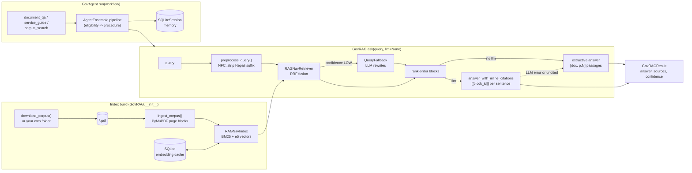

<div align="center">

# Nepal GovAgent

**Cited, offline-capable question answering over Nepal's government policy and legal PDFs, in Nepali and English.**

[](https://pypi.org/project/nepal-gov-agent/)
[](https://pypi.org/project/nepal-gov-agent/)
[](https://pepy.tech/projects/nepal-gov-agent)
[](https://github.com/irfanalidv/Nepal-Gov-Agent/actions/workflows/tests.yml)
[](https://github.com/irfanalidv/Nepal-Gov-Agent/actions/workflows/codeql.yml)
[](https://github.com/irfanalidv/Nepal-Gov-Agent/blob/main/LICENSE)
[](https://github.com/astral-sh/ruff)
[](https://mypy-lang.org/)
[](https://github.com/irfanalidv/Nepal-Gov-Agent/blob/main/CONTRIBUTING.md)

</div>

## Why

An answer about citizenship rules or the National AI Policy is only useful if a citizen or
official can check it against the source document. Nepal GovAgent is a reference implementation
of that retrieval-and-citation layer: it indexes a folder of government PDFs, answers Nepali or
English questions with the exact document and page behind every passage, reports how confident
retrieval was, and runs on a laptop with no API key. An LLM is optional and only writes the final
answer; retrieval always stays local.

> **Status: maintenance.** A published reference implementation, not a roadmapped product. Issues
> and PRs are welcome; new feature work is best-effort. It is a research prototype, not cleared for
> official government use (see [Scope and limitations](#scope-and-limitations)).

## Features

| | |
|---|---|
| **Hybrid retrieval** | BM25 + multilingual dense embeddings (`intfloat/multilingual-e5-small`), fused with Reciprocal Rank Fusion, via [RAGNav](https://pypi.org/project/ragnav/) |
| **Citations** | Every source carries `doc`, `page`, `block_id` and an excerpt; LLM answers must cite `[[block_id]]` per sentence or fall back to the extractive answer |
| **Nepali + English** | Unicode NFC normalisation and Nepali question-suffix stripping; one index serves both languages |
| **Offline by default** | Extractive answers with no LLM; optional local [Ollama](https://ollama.com/) client; SQLite embedding cache |
| **Confidence + fallback** | Retrieval confidence (`high`/`medium`/`low`); low-confidence queries are retried with LLM rewrites (RAGNav `QueryFallback`) |
| **Agent workflows** | `GovAgent`: `document_qa`, `service_guide` (eligibility, then procedure) and `corpus_search`, with SQLite session memory ([AgentEnsemble](https://pypi.org/project/agentensemble/)) |
| **Evaluation** | Recall@k / keyword / document hit-rate harness, a 7-question smoke test and a labelled 96-pair synthetic set |
| **CLI** | `nepal-gov-agent download / ask / agent / benchmark / stats` |
| **Typed** | Ships `py.typed`; checked with mypy |

## Install

Requires Python 3.10+.

```bash
pip install nepal-gov-agent
# or
uv add nepal-gov-agent            # inside a uv project
uv pip install nepal-gov-agent    # into the active environment
```

Optional extras:

```bash
pip install "nepal-gov-agent[mistral]"   # Mistral client for cited LLM answers
pip install "nepal-gov-agent[eval]"      # OpenAI client for synthetic eval generation
pip install "nepal-gov-agent[web]"       # FastAPI frontend (python web/app.py from a clone)
pip install "nepal-gov-agent[demo]"      # Gradio demo (python demo/app.py from a clone)
pip install "nepal-gov-agent[dev]"       # pytest, coverage, ruff, mypy, pre-commit, build, twine
```

PDFs are not bundled on PyPI or in git. `download_corpus()` (or `nepal-gov-agent download`) fetches
five public seed PDFs into `./nepal_gov_data/`, or you can point `GovRAG` at any folder of PDFs.
The first run also downloads the embedding model from Hugging Face; after that everything works
offline.

## Quickstart

```python
from nepal_gov_agent import GovAgent, GovRAG, download_corpus

rag = GovRAG(corpus_dir=download_corpus())  # five seed PDFs -> ./nepal_gov_data/

result = rag.ask("What is the role of the National AI Centre?")
print(result.confidence)                     # "high" | "medium" | "low"
for src in result.sources[:3]:
    print(src["doc"], "page", src["page"])

# Multi-step workflow with SQLite session memory
agent = GovAgent(rag=rag, session_id="demo")
guide = agent.run("citizenship certificate renewal", workflow="service_guide")
print(guide.workflow, len(guide.steps), "steps,", len(guide.sources), "sources")
```

Output from a run on 2026-10-31 (v0.6.0, default config, seed corpus):

```text
medium
National AI Policy-Final_uxc94vg.pdf page 42
National AI Policy-Final_uxc94vg.pdf page 18
National AI Policy-Final_uxc94vg.pdf page 38
service_guide 2 steps, 12 sources
```

`result.answer` is extractive: the top passages, each prefixed with `[document, p.N]`. Pass
`llm=` to `ask()` for a written answer with inline citations (see
[`cited_answers_llm.py`](https://github.com/irfanalidv/Nepal-Gov-Agent/blob/main/examples/cited_answers_llm.py)).

CLI equivalents:

```bash
nepal-gov-agent download
nepal-gov-agent ask "नेपालको राष्ट्रिय AI नीतिको उद्देश्य के हो?"
nepal-gov-agent agent "citizenship renewal" --workflow service_guide --session alice
nepal-gov-agent benchmark            # add --synthetic for the 96-pair LLM-generated set
nepal-gov-agent stats
```

## How it works



Key design decisions:

- **Retrieval is local; generation is optional.** Without an `llm` the answer is the cited
  passages themselves, so nothing leaves the machine and nothing can be hallucinated. With an `llm`,
  RAGNav rejects answers that leave a sentence uncited or cite an unknown block, and GovRAG logs the
  failure and returns the extractive answer instead of raising.
- **Rank order is preserved.** RAGNav's structure expansion returns blocks in document order;
  GovRAG restores score order from the retrieval trace so `sources[0]` is the best match. (Before
  v0.6.0 this was not the case; see [Benchmark](#benchmark).)
- **RRF fusion by default.** Rank-based fusion needs no score calibration between BM25 and cosine
  similarity. Under RRF, `w_bm25` / `w_vec` only switch a retriever on or off; set
  `fusion="weighted"` to blend normalised scores with those weights.
- **Fallback only on LOW confidence**, so confident queries never pay for rewrites. Rewrites come
  from the `llm` you pass; without one RAGNav's offline stub just echoes the prompt.
- **Embedding cache keyed to the model.** Changing `embedding_model` clears the cache, so vectors
  from two models are never mixed.
- **Errors are typed.** Everything raised derives from `NepalGovAgentError` and also from the
  built-in type older releases raised (`FileNotFoundError`, `ValueError`, `RuntimeError`).

## Use cases and recipes

| Script | What it shows | Needs |
|---|---|---|
| [`citizen_helpdesk.py`](https://github.com/irfanalidv/Nepal-Gov-Agent/blob/main/examples/citizen_helpdesk.py) | Eligibility + procedure answers (`service_guide`) and follow-ups stored per citizen session | Offline mini corpus |
| [`bring_your_own_corpus.py`](https://github.com/irfanalidv/Nepal-Gov-Agent/blob/main/examples/bring_your_own_corpus.py) | Your own PDF folder, weighted fusion, `allowed_doc_ids` scoping, raw `search`, a Nepali query on English PDFs | Offline mini corpus |
| [`cited_answers_llm.py`](https://github.com/irfanalidv/Nepal-Gov-Agent/blob/main/examples/cited_answers_llm.py) | `ask(llm=...)` with `[[block_id]]` citations; stub LLM offline or `--ollama` for a local model | Offline (Ollama optional) |
| [`quickstart.py`](https://github.com/irfanalidv/Nepal-Gov-Agent/blob/main/examples/quickstart.py) | English and Nepali questions on the real seed corpus, with page citations | Network on first run |
| [`benchmark_corpus.py`](https://github.com/irfanalidv/Nepal-Gov-Agent/blob/main/examples/benchmark_corpus.py) | Smoke-test benchmark plus your own QA pairs for regression tracking | Network on first run |
| [`Nepal_GovAgent_Demo.ipynb`](https://colab.research.google.com/github/irfanalidv/Nepal-Gov-Agent/blob/main/examples/Nepal_GovAgent_Demo.ipynb) | Colab walkthrough of the seed corpus with business-style questions | Colab; LLM cells need a reachable Ollama server |

"Offline mini corpus" scripts generate three small PDFs on the fly
([`_mini_corpus.py`](https://github.com/irfanalidv/Nepal-Gov-Agent/blob/main/examples/_mini_corpus.py));
they need no key and no network once the embedding model is cached.

<details>
<summary><b>Cited answers with a real LLM (Ollama or Mistral)</b></summary>

Local, no key (`ollama serve` and `ollama pull qwen2.5:7b` first):

```python
from nepal_gov_agent import GovRAG, OllamaClient

rag = GovRAG(corpus_dir="./nepal_gov_data/")
result = rag.ask("How many AI professionals does Nepal aim to train?", llm=OllamaClient())
print(result.answer, result.cited_block_ids)
```

Hosted (needs `pip install "nepal-gov-agent[mistral]"` and `MISTRAL_API_KEY`):

```python
from ragnav.llm.mistral import MistralClient

result = rag.ask("How many AI professionals does Nepal aim to train?", llm=MistralClient())
```

These two snippets need a running Ollama daemon or a Mistral key and were not run for this README.
</details>

## Configuration

`GovRAGConfig` (frozen dataclass, validated on construction):

| Field | Default | Meaning |
|---|---|---|
| `embedding_model` | `intfloat/multilingual-e5-small` | sentence-transformers model for dense retrieval |
| `fusion` | `"rrf"` | `"rrf"` (rank-based) or `"weighted"` (min-max score blend) |
| `w_bm25`, `w_vec` | `0.5`, `0.5` | Score weights under `"weighted"`; under `"rrf"`, 0 disables that retriever |
| `k_bm25`, `k_vec` | `30`, `30` | Candidates taken from each retriever before fusion |
| `k_final` | `8` | Blocks kept per question (`ask(k_final=...)` overrides) |
| `max_fallback_attempts` | `3` | QueryFallback attempts on LOW confidence (`1` disables) |
| `cache_dir` | `.nepal_gov_cache` | SQLite embedding cache folder |
| `offline`, `language` | `True`, `"auto"` | Informational / reserved; they do not change retrieval |

`GovAgentConfig.session_db` (default `gov_agent_sessions.db`) sets the session-memory file.
`OllamaClient(model="qwen2.5:7b", base_url="http://localhost:11434", timeout=120.0)`.

Environment variables (the core library needs none):

| Variable | Used by | Purpose |
|---|---|---|
| `MISTRAL_API_KEY` | `ragnav.llm.mistral.MistralClient` (`[mistral]`) | Cited answers via Mistral |
| `OPENAI_API_KEY` | `python -m nepal_gov_agent.eval.generate` (`[eval]`) | Synthetic eval generation (or pass `api_key=`) |
| `NGA_CORPUS_DIR` | `web/app.py`, `demo/app.py` | Use an existing PDF folder instead of downloading |
| `NGA_CACHE_DIR` | `web/app.py`, `demo/app.py` | Cache folder (default `.nepal_gov_cache`) |
| `NEPAL_GOV_CORPUS_DIR` | test suite | Run tests against the real seed corpus |

## API overview

| Object | Purpose |
|---|---|
| `GovRAG(corpus_dir, config)` | Build the index. `.ask(query, llm=None, k_final=None, with_citations=True, allowed_doc_ids=None)` returns `GovRAGResult`; `.search(query, k)` returns ranked raw blocks; `.stats` |
| `GovRAGResult` | `answer`, `sources`, `cited_block_ids`, `confidence`, `query_used`, `fallback_triggered` |
| `GovAgent(rag, config, session_id)` | `.run(query, workflow="document_qa", k_final=None)` returns `GovAgentResult`; `.history`, `.clear_history()` |
| `GovRAGConfig`, `GovAgentConfig` | Settings (see above) |
| `OllamaClient` | Local LLM for `ask(llm=...)` |
| `download_corpus(dest_dir, force)` | Fetch the five seed PDFs |
| `preprocess_query(text)` | The query normalisation used by `ask` / `search` |
| `run_benchmark(rag, qa_pairs=None, k_values=None)` | Retrieval metrics; returns `BenchmarkResult` (`.report()`) |
| `run_synthetic_benchmark`, `load_synthetic_qa`, `generate_synthetic_qa` | Synthetic eval set |
| `NepalGovAgentError` and subclasses | `CorpusNotFoundError`, `EmptyCorpusError`, `CorpusDownloadError`, `LLMUnavailableError`, `MissingDependencyError` |

## Benchmark

The harness measures **retrieval**, not answer quality: a query counts as a hit at k when any
expected keyword appears in the top-k retrieved blocks. Numbers below come from one run on
2026-10-31 with v0.6.0, the default config and the five seed PDFs (5 documents, 327 blocks).
Run `nepal-gov-agent benchmark` for numbers on your install.

| Eval set | Queries | Recall@1 | Recall@3 | Recall@5 | Doc hit | English R@3 | Nepali R@3 |
|---|---|---|---|---|---|---|---|
| Hand-curated smoke test | 7 | 0.714 | 1.000 | 1.000 | 1.000 | 1.000 | 1.000 (1 query) |
| Synthetic, LLM-generated, **not human-validated** | 96 | 0.490 | 0.604 | 0.656 | 0.688 | 0.707 | 0.238 |

- The smoke test is seven questions: a "is anything broken" check, not a benchmark.
- The synthetic set was drafted by `gpt-4.1-mini` from the corpus pages, keeping only pairs whose
  keywords occur verbatim in the source page. Use it as a regression signal, not ground truth; see
  [`eval_data/README.md`](https://github.com/irfanalidv/Nepal-Gov-Agent/blob/main/eval_data/README.md)
  and [`docs/synthetic-eval.md`](https://github.com/irfanalidv/Nepal-Gov-Agent/blob/main/docs/synthetic-eval.md).
- **Nepali queries retrieve much worse than English ones** (0.238 vs 0.707 Recall@3 on the
  synthetic set). Part of that is the embedding model, part is likely LLM-translated test questions;
  separating the two needs native-speaker review.
- The v0.6.0 rank-order fix moved synthetic Recall@1 from 0.229 to 0.490 and Recall@3 from 0.490 to
  0.604 on the same corpus and config; v0.5.0 scored blocks in document order.

## Research and references

The retrieval stack, implemented in RAGNav and used here, builds on:

- **BM25**: S. Robertson and H. Zaragoza, "The Probabilistic Relevance Framework: BM25 and Beyond,"
  *Foundations and Trends in Information Retrieval* 3(4), 2009.
- **Reciprocal Rank Fusion** (k = 60): G. V. Cormack, C. L. A. Clarke and S. Büttcher, "Reciprocal
  Rank Fusion Outperforms Condorcet and Individual Rank Learning Methods," *SIGIR* 2009.
- **Multilingual E5** (default embedding model): L. Wang et al., "Multilingual E5 Text Embeddings:
  A Technical Report," arXiv:2402.05672, 2024.

## When to use it

- **Good fit:** a worked, readable example of cited RAG over a sovereign legal/policy corpus; a
  starting point for a Nepali-government document assistant; offline or air-gapped prototypes;
  teaching hybrid retrieval with honest evaluation.
- **Poor fit:** production government deployment as-is, scanned PDFs without OCR, or workloads that
  need strong Nepali-to-Nepali retrieval today (see the benchmark gap above).

<details>
<summary><b>Seed corpus and bring-your-own corpus</b></summary>

`download_corpus()` pulls five public files into `./nepal_gov_data/` from the pinned `v0.4.0` tag:

| Document | Language |
|---|---|
| National AI Policy 2082 | English |
| Constitution of Nepal (2nd amendment) | English |
| Digital Nepal Framework 2.0 | English |
| प्रतिनिधि सभा सदस्य निर्वाचन (पहिलो संशोधन) अध्यादेश २०८२ | Nepali |
| मानव अधिकार पुरस्कार कोष सञ्चालन नियमावली २०७५ | Nepali |

It omits the Law Commission's *Legal Maxims* volume (`1714977234_32.pdf`): it is very large and
tends to dominate hybrid retrieval over the shorter Nepali ordinances.

Any flat folder of PDFs works (`GovRAG(corpus_dir="./my_ministry_docs/")`); subfolders are not
scanned, and scanned (image-only) PDFs need OCR first. If you know of publicly available Nepal
government PDFs, opening an issue with links is the most useful contribution.
</details>

<details>
<summary><b>Nepal context</b></summary>

- **August 2025**: Nepal's Cabinet approved the
  [National AI Policy 2082](https://aiassociationnepal.org/national-artificial-intelligence-ai-policy-2082/).
- **February 2026**: the World Bank
  [approved a $50M](https://coingeek.com/nepal-secures-50m-for-digitalization-approved-by-world-bank/)
  Nepal Digital Transformation Project.
- Citizen-facing services such as the [Nagarik App](https://nagarikapp.gov.np/) already exist; this
  project explores the retrieval-and-citation layer over the legal and policy documents beneath them.
</details>

## Scope and limitations

Nepal GovAgent is a research prototype. The benchmark measures retrieval, not answer safety,
factual correctness or suitability for official use. Any government deployment would also need a
security audit, data-sovereignty controls, a human review step for every answer, and official
approval and integration. `GovRAG` instances are bound to the thread that created them (SQLite);
`web/app.py` shows a single-worker pattern for serving.

## Roadmap

Open for contributors; no committed timeline:

- Native-speaker review of the synthetic set and a small human-validated subset.
- Better Nepali retrieval: proper tokenisation / transliteration (e.g. IndicNLP or Stanza) and
  embedding-model comparisons.
- Corpus expansion (ministry circulars 2080-2082) and an index over amendments.
- Answer-quality evaluation (LLM-as-judge with human spot checks).

Open an issue before starting anything large.

## Contributing, security, citation, license

- [CONTRIBUTING.md](https://github.com/irfanalidv/Nepal-Gov-Agent/blob/main/CONTRIBUTING.md): setup,
  tests (`pytest --cov=nepal_gov_agent`), `ruff check`, `ruff format`, `mypy nepal_gov_agent`, and
  `pre-commit install`.
- [SECURITY.md](https://github.com/irfanalidv/Nepal-Gov-Agent/blob/main/SECURITY.md): how to report a
  vulnerability.
- [CHANGELOG.md](https://github.com/irfanalidv/Nepal-Gov-Agent/blob/main/CHANGELOG.md): release history.
- Cite via [CITATION.cff](https://github.com/irfanalidv/Nepal-Gov-Agent/blob/main/CITATION.cff)
  (GitHub's "Cite this repository" button).
- Built on [RAGNav](https://github.com/irfanalidv/RAGNav) (ingestion, retrieval, citations,
  fallback) and [AgentEnsemble](https://github.com/irfanalidv/AgentEnsemble) (pipeline, session
  memory), both MIT and on PyPI. [ragfallback](https://github.com/irfanalidv/ragfallback) is a
  declared dependency but is not imported by the package today.
- [MIT License](https://github.com/irfanalidv/Nepal-Gov-Agent/blob/main/LICENSE). Built by
  [Irfan Ali](https://github.com/irfanalidv) ([DataCortex IQ](https://www.datacortex.in/)).
